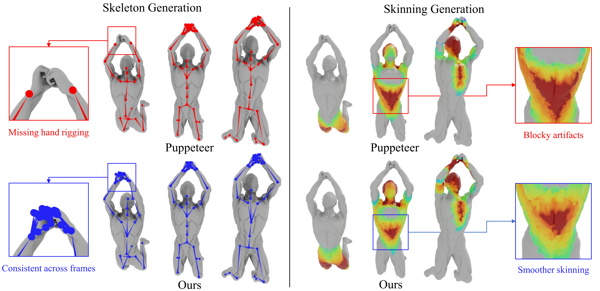

# SPRig: Self-Supervised Pose-Invariant Rigging from Mesh Sequences

<div align="center">

**Ruipeng Wang**<sup>1*</sup> &nbsp; **Langkun Zhong**<sup>2*</sup> &nbsp; **Miaowei Wang**<sup>3</sup>

<sup>1</sup>University of Pennsylvania &nbsp; <sup>2</sup>The University of Hong Kong &nbsp; <sup>3</sup>The University of Edinburgh
<br>
(* Equal contribution)

<a href="https://arxiv.org/abs/2602.12740"></a>
<a href="https://arxiv.org/pdf/2602.12740"></a>
<a href="https://wangruipeng.com/SPRig"></a>

</div>

---

> **TL;DR:** Since an animated sequence represents the same underlying object, we enforce a consistency prior to fine-tune existing rigging models, enabling them to learn robust, pose-invariant rigs from abundant unlabeled data.

<div align="center">
  
</div>

Comparison of our method vs Puppeteer. Our method (top, blue) yields a complete, temporally consistent skeleton with smooth, coherent skinning weights, whereas Puppeteer (bottom, red) produces an incomplete skeleton with missing hand rigging and unstable, blocky skinning.

---

## Code

The implementation is available in [`src/`](src/).

| Directory | Contents |
| :--- | :--- |
| [`src/skeleton/`](src/skeleton/) | Skeleton prediction and fine-tuning |
| [`src/skinning/`](src/skinning/) | Skinning prediction and fine-tuning |
| [`src/tools/`](src/tools/) | Inference and supporting utilities |
| [`docs/`](docs/) | Project website |

## Pretrained Models

The checkpoints used in the paper, fine-tuned on DeformingThings4D, are available on [Hugging Face](https://huggingface.co/wrp/SPRig).

| Stage | Model version | Checkpoint |
| :--- | :--- | :--- |
| Skeleton | `DeformingThings4D_finetune_v2` | [`sprig_dt4d_skeleton.pth`](https://huggingface.co/wrp/SPRig/blob/main/sprig_dt4d_skeleton.pth) |
| Skinning | `finetuned_model_v3` | [`sprig_dt4d_skinning.pth`](https://huggingface.co/wrp/SPRig/blob/main/sprig_dt4d_skinning.pth) |

Our pretrained weights can be used in the original [Puppeteer repository](https://github.com/Seed3D/Puppeteer) in place of its skeleton and skinning checkpoints. Set `--pretrained_weights` to the corresponding file above, with the model settings and loading adjustment below.

<details>
<summary>Using the checkpoints in Puppeteer</summary>

- **Skeleton v2:** use `--joint_token` and remove `--seq_shuffle` from Puppeteer's `demo_rigging.sh`. Keep the default OPT-350m model, 128 coordinate bins, and `--n_max_bones 100`.
- **Skinning v3:** use `--depth 1`. This checkpoint already uses Puppeteer's `{"model": ...}` format and works with its existing checkpoint loader.

The skeleton checkpoint is saved as a raw state dictionary. In Puppeteer's `skeleton/demo.py`, replace `model.load_state_dict(pkg["model"])` with:

```python
model.load_state_dict(pkg.get("model", pkg), strict=True)
```

</details>

## Online Demo

[](https://colab.research.google.com/drive/1H8IQ2ZjXdOeMpo6Sdf73bxXkz0EZyfEz)

The standalone Colab notebook is maintained separately in Google Drive. It downloads a fixed revision of the source code from this repository and the pretrained weights from Hugging Face.

1. Open the notebook and select **Runtime → Change runtime type → A100**.
2. Choose **Runtime → Run all**. The notebook automatically downloads the official Puppeteer deer example and runs skeleton and skinning prediction.
3. Inspect the interactive skeleton and skinning-weight previews, then download the results as a ZIP file.

The demo has been run successfully on an **NVIDIA A100 (40 GB)**. The first run includes environment setup and model downloads.

Results include the exported mesh, predicted skeleton, and per-vertex skinning weights. The skinning weights follow the vertex order of the exported mesh. The demo produces a rig in its rest pose.

## Data

The datasets used in the paper are **not redistributed**. Please obtain them from their original providers and follow the corresponding terms of use.

## Citation

If you find our work useful for your research, please consider citing:

```bibtex
@misc{wang2026sprig,
  title={SPRig: Self-Supervised Pose-Invariant Rigging from Mesh Sequences},
  author={Ruipeng Wang and Langkun Zhong and Miaowei Wang},
  year={2026},
  eprint={2602.12740},
  archivePrefix={arXiv},
  primaryClass={cs.CV},
  url={https://arxiv.org/abs/2602.12740}
}
```
